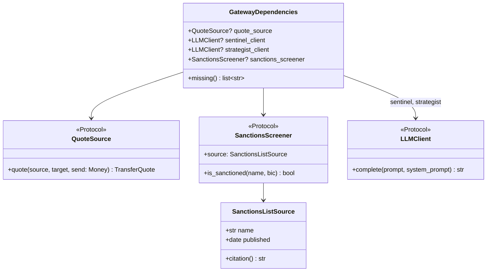
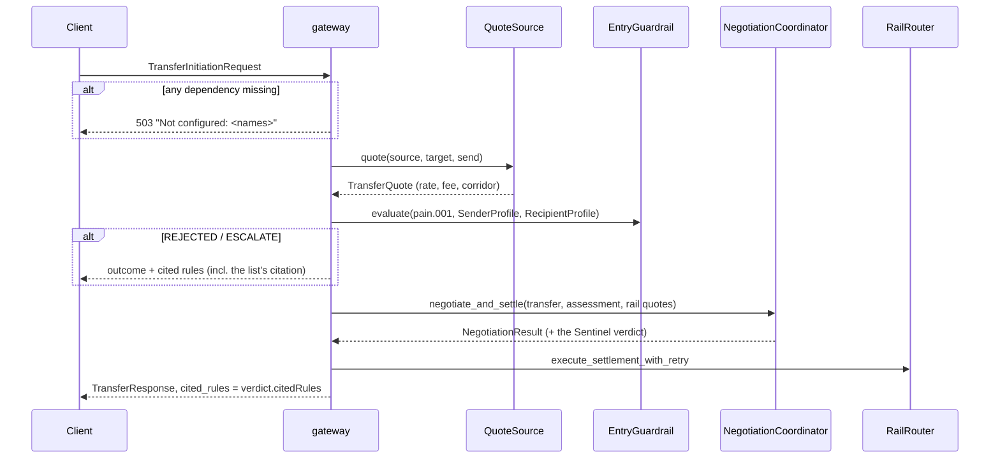

# Design — `gateway` (HTTP intake)

**Status:** agreed · **Owner:** Kirito (Claude) · **Tasks:** T041a, T043, T044, T073, T074 ·
**Spec:** [SPEC.md](../../SPEC.md) US1, US5

> Written retroactively. The gateway landed in PR #12 with no task and no design doc, and served
> fabricated rates, verdicts and balances (T073). This doc draws the shape it was rebuilt to.

---

## 1. What this covers

The FastAPI service in `services/gateway/` that turns an HTTP request into a priced, screened and
negotiated transfer. It owns request validation and wiring; it decides nothing itself. Screening is
[asco-orchestrator.md](asco-orchestrator.md) §3, negotiation §4, messages
[iso20022-messaging.md](iso20022-messaging.md), settlement `services/rails`. The pages that will
call it are [frontend-web.md](frontend-web.md) §4 (T025).

## 2. Reference material

| Kind | Where |
| --- | --- |
| Existing code this must match | `services/gateway/src/ubunturemit_gateway/` |
| The rule it exists to keep | PLAN.md Non-negotiable I — every rate, verdict and confirmation traces to a source |

## 3. Components — every external fact has one source, and none has a default

`create_app(dependencies)` stores one `GatewayDependencies` on `app.state`, beside a fresh
`GatewayRuntime` (orchestrator, audit logger, and the responses already given) — nothing is
shared between app instances. **There is no
production implementation of any of the four yet**, so the module-level `app` answers 503 on every
endpoint that needs one. That is the correct behaviour today, not a gap to paper over:

| Source | What would provide it | Until then |
| --- | --- | --- |
| `quote_source` | a live FX rate provider | `GET /api/fx/quote`, `POST /api/transfers` → 503 |
| `sentinel_client`, `strategist_client` | `services/inference` — vLLM on the MI300X ([asco-orchestrator.md](asco-orchestrator.md) §3, *planned*) | `POST /api/transfers` → 503 |
| `sanctions_screener` | a published list (e.g. the UN consolidated list) loaded with its own date | `POST /api/transfers` → 503 |

Rail quotes still come from `ubunturemit_rails.RailRouter`; T052–T054 govern those.

## 4. `POST /api/transfers`

## 5. Contracts

- **Every source is checked before any work.** A transfer is either priced, screened and assessed by
  real sources, or refused with 503 naming each missing one.
- **Compliance inputs come from the caller.** `sender_kyc_tier` (exactly `L1`/`L2`/`L3` — never
  coerced, since it selects the single-transfer limit), `sender_prior_transfers_30d_count`,
  `sender_prior_transfers_30d_minor_units` and `recipient_account_age_days` are required request
  fields: the gateway has no transfer history or account register, and a default would be a
  fabricated fact fed to the velocity and account-age checks.
- **`cited_rules` in a response is the verdict's own** (`NegotiationResult.verdict.cited_rules`), or
  the entry gate's on a rejection — never a list written in the route. An entry-gate rejection
  moves the transfer to `REJECTED`. `GET /api/transfers/{id}` returns the stored response the
  POST answered with, citations included.
- **A Strategist that times out or produces no valid proposal escalates** (`PENDING_REVIEW`,
  audited with `deterministicOverride`), as the Sentinel does — never a 500, never a settlement.
- **`GET /api/compliance/health`** reports the wiring, nothing more: `status` is `OPERATIONAL` only
  when `missing_dependencies` is empty; `rules_enforced` is `ENTRY_GATE_RULES` from the entry
  guardrail; `sanctions_list` is the loaded list's citation or `null`; `rejection_rate_24h` and
  `total_screened_24h` are `null` until a persistent screening history exists (T050a); `audit_log`
  names the audit sink type in use. It names no hardware and no model size.
- **Removed:** `GET /api/wallet` and `GET /api/session` returned a real bank's name with invented
  balances and settlements. They come back when a ledger and an identity source exist — **T074**.

## 6. How this is verified

`pytest services/gateway`: the unconfigured app refuses each endpoint and names what is missing;
the configured path (test doubles in `tests/gateway_fakes.py`, each named as one) cites the verdict
and the list it used; omitting a compliance input is a 422.
