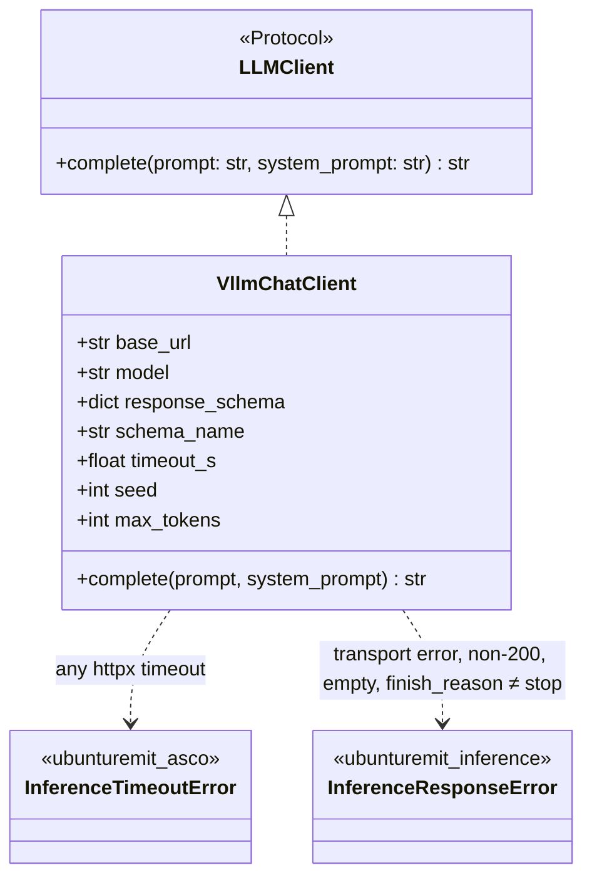
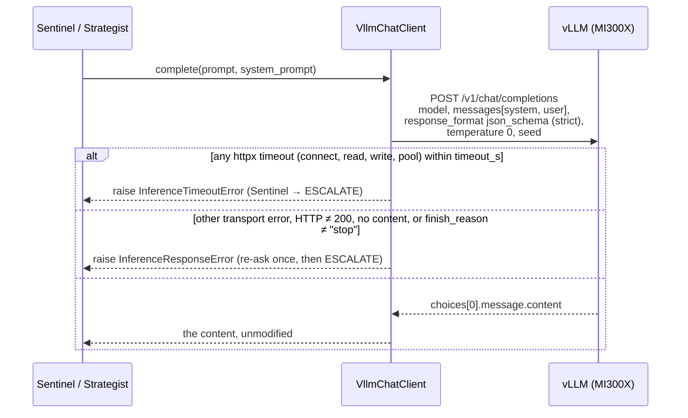

# Design — `inference` (the model client and its server)

**Status:** draft — awaiting Kirito's review · **Owner:** Kirito (Claude) · **Tasks:** T076 (this doc), T078–T080 ·
**Spec:** [SPEC.md](../../SPEC.md) US2

---

## 1. What this covers

How the Compliance Sentinel and the Liquidity Strategist reach a model: the `LLMClient`
implementation that calls vLLM, and the vLLM deployment it calls. It does **not** cover what the
agents do with a reply — parsing, re-asking once, escalating — which stays in
[asco-orchestrator.md](asco-orchestrator.md) §4–§5 and is already built.

Today neither agent can be constructed in a deployment: they refuse without a client (T043/T044),
and the gateway answers 503 without `sentinel_client` / `strategist_client`
([gateway.md](gateway.md) §3). This design is what fills those two slots.

## 2. Reference material

| Kind | Where |
| --- | --- |
| Server | vLLM **0.26.0** (PLAN.md Technical Context), OpenAI-compatible server, on ROCm 7.0 / one MI300X |
| Constrained decoding | vLLM structured outputs — `response_format: {"type": "json_schema", ...}`; `guided_json` was removed in v0.12.0 ([docs](https://docs.vllm.ai/en/latest/features/structured_outputs.html), checked 2026-10-11) |
| The contract it implements | `ubunturemit_asco.LLMClient` — `complete(prompt, system_prompt) -> str` |
| Schemas it enforces | [asco-orchestrator.md](asco-orchestrator.md) §5 — restated as JSON Schema in §5 below |

## 3. Components



- **One client per agent**, each bound to its agent's schema at construction. The `LLMClient`
  protocol stays unchanged, so nothing in `services/asco` changes.
- `VllmChatClient` lives in `services/inference/` (its own package, per
  [project-structure.md](../project-structure.md)), which **depends on `ubunturemit-asco`** and
  imports `LLMClient` and `InferenceTimeoutError` from it. That exact class matters: the agents
  catch `ubunturemit_asco.InferenceTimeoutError`, and a look-alike defined elsewhere would turn a
  timeout into a re-ask — doubling latency inside the RTGS window and auditing it as malformed
  output. `InferenceResponseError` is the inference package's own. `services/asco` never imports
  `services/inference`; whatever wires the agents (the gateway) does.
- **Constrained decoding is not trusted alone.** The agents still parse and validate every reply
  (§5 of the ASCO doc). The schema makes a malformed reply rare; the parser makes it harmless.

## 4. A call



- **Errors map onto the paths the agents already have.** Every `httpx.TimeoutException` is
  `InferenceTimeoutError`, which the Sentinel turns into ESCALATE and the coordinator escalates for
  the Strategist. Every other `httpx.TransportError` (connection refused, DNS failure), a non-200,
  a reply with no `choices[0].message.content`, and any `finish_reason` other than `"stop"` is
  `InferenceResponseError`, which takes the re-ask-then-escalate path.
- `"length"` means truncated JSON; `"abort"` or any other reason means the model did not finish.
  Neither is a reply.
- **The client never repairs, trims or defaults a reply.** It returns the model's text or raises.

## 5. Contracts — the schemas sent as `response_format`

Restated from [asco-orchestrator.md](asco-orchestrator.md) §5 as JSON Schema. Where they differ,
§5 of that doc wins and this section is the bug. Each block below is the `json_schema` member of
the request: `"response_format": {"type": "json_schema", "json_schema": <block>}`. The arrays are
bounded so that a repetition loop at temperature 0 hits a schema limit, not `max_tokens`.

**Unverified until T079:** whether vLLM 0.26.0's structured-output backends honour `strict` and
every keyword used here (`maxLength`, `pattern`, `exclusiveMinimum`, `maxItems`, `uniqueItems`).
The vLLM docs page checked on 2026-10-11 does not say. The agents' own validation holds either way
(§3), so an unsupported keyword weakens decoding, never the decision.

```json
{
  "name": "ComplianceVerdict",
  "strict": true,
  "schema": {
    "type": "object",
    "additionalProperties": false,
    "required": ["outcome", "riskScore", "citedRules", "rationale"],
    "properties": {
      "outcome": {"enum": ["PASS", "ESCALATE", "BLOCK"]},
      "riskScore": {"type": "number", "minimum": 0, "maximum": 1},
      "citedRules": {
        "type": "array", "minItems": 1, "maxItems": 20,
        "items": {"type": "string", "minLength": 1, "maxLength": 200}
      },
      "rationale": {"type": "string", "maxLength": 600},
      "constraints": {
        "type": "object",
        "additionalProperties": false,
        "properties": {
          "forbiddenRails": {
            "type": "array", "maxItems": 3, "uniqueItems": true,
            "items": {"enum": ["RIPPLE", "SWIFT", "PAPSS"]}
          },
          "maxSettlementSeconds": {"type": "number", "exclusiveMinimum": 0}
        }
      }
    }
  }
}
```

```json
{
  "name": "LiquidityProposal",
  "strict": true,
  "schema": {
    "type": "object",
    "additionalProperties": false,
    "required": ["rail", "totalCost", "estimatedSeconds", "rationale"],
    "properties": {
      "rail": {"enum": ["RIPPLE", "SWIFT", "PAPSS"]},
      "totalCost": {
        "type": "object",
        "additionalProperties": false,
        "required": ["minorUnits", "currency"],
        "properties": {
          "minorUnits": {"type": "integer", "minimum": 0},
          "currency": {"type": "string", "pattern": "^[A-Z]{3}$"}
        }
      },
      "estimatedSeconds": {"type": "number", "exclusiveMinimum": 0},
      "rationale": {"type": "string", "maxLength": 400}
    }
  }
}
```

Request fields set by the client: `temperature: 0`, the configured `seed`, and the configured
`max_tokens`. With every string and array bounded, the longest valid reply is finite; T079 measures
it in tokens for each chosen model and sets `max_tokens` above it. Until then it is a required
constructor argument with no default.

## 6. Serving

| Decision | Choice | Why |
| --- | --- | --- |
| Processes | Two vLLM servers on the one MI300X, one per model, each with its own `--gpu-memory-utilization` share | PLAN.md: both models co-resident on one node; separate processes keep one model's failure from taking the other down |
| Structured-output backend | vLLM's default (`auto`) | No measured reason to pin one yet |
| Reachability | Inside the institution's network only; the client takes `base_url` from deployment config | PLAN.md: no third-party LLM API, ever. Enforced by network egress policy, not by the client guessing which hosts are third-party |
| Checkpoints | **Not chosen** — 70B-class (Sentinel) and 32B-class (Strategist) per PLAN.md | Choosing them is T080 |
| Quantisation | Not adopted | FP8 is an untested hypothesis until T061 measures it |

## 7. How this is verified

- **T078 (buildable now):** unit tests against `httpx.MockTransport` — the request body carries the
  `response_format` envelope with the schema, `temperature 0`, the seed and `max_tokens`; a read
  timeout and a connect timeout each raise `ubunturemit_asco.InferenceTimeoutError` (asserted as
  that exact class); a refused connection, a 500, an empty `choices`, missing `content`,
  `finish_reason: "length"` and `"abort"` each raise `InferenceResponseError`; a valid reply is
  returned byte-for-byte.
- **T079 (needs the MI300X):** both servers up; one real call per agent returns JSON that the
  agent's own parser accepts.
- **T060 / T062** then run against these clients instead of mocks.

## 8. Open questions

1. **Per-request rail enum.** The Strategist's schema could narrow `rail` to the rails actually
   quoted for that transfer, making an unoffered rail impossible rather than rejected by the exit
   validator. That needs the schema per call, which `LLMClient.complete` does not take. Not needed
   for correctness — the exit validator already rejects it — so deferred.
2. **Determinism.** `temperature 0` plus a fixed seed is the request side; whether vLLM's output is
   then identical across batch sizes and restarts is exactly what T060 measures. Nothing here
   claims it.
